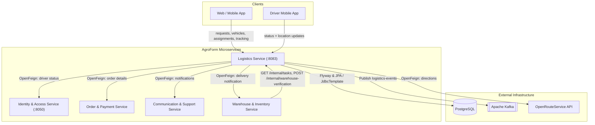
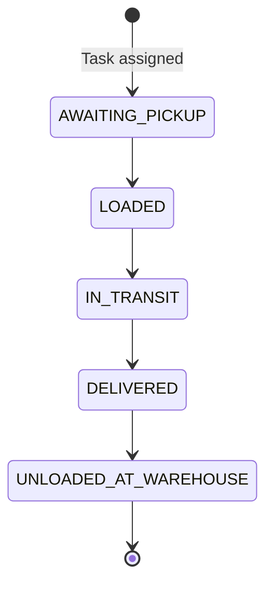
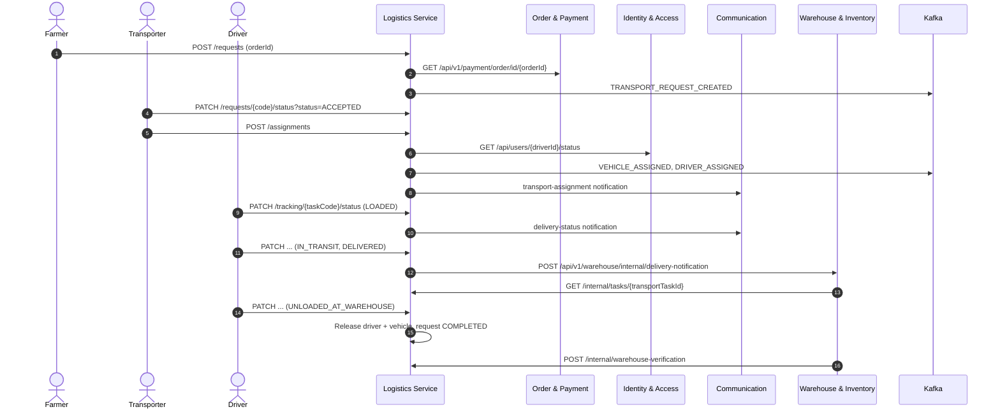
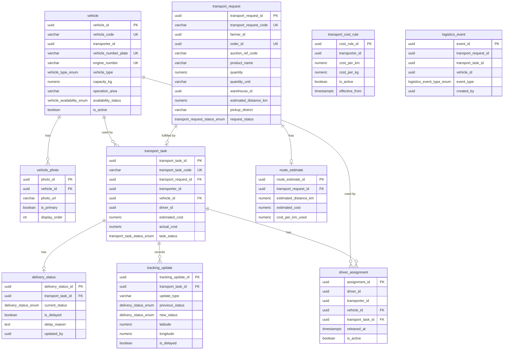

# AgroForm Logistics Service

[](https://spring.io/projects/spring-boot)
[](https://www.oracle.com/java/)
[](https://www.postgresql.org/)
[](https://kafka.apache.org/)
[](https://flywaydb.org/)

The **Logistics Service** is a microservice within the **AGROFORM National Agriculture & Food Supply Chain Digital Platform**. It manages the movement of produce from the farm to the warehouse after an order has been paid: vehicle registration, transport requests, driver and vehicle assignment, transport cost previews, delivery status and live-location tracking, delay handling, warehouse delivery verification, and an append-only logistics audit trail published to Kafka.

> This README describes the code on the `pre-dev` branch. Items that were found in the code but not tested are listed in [section 19](#19-known-gaps--items-not-verified).

### Quick Start

```bash
git clone https://github.com/gamageRecruitersIT/agroform-logistics-service.git
cd agroform-logistics-service
# create src/main/resources/application.properties (see section 12)
mvn spring-boot:run
```

Then get a test token and call an API:

```bash
curl "http://localhost:8083/api/test/token?role=TRANSPORTER&userId=00000000-0000-0000-0000-000000000001"
curl -H "Authorization: Bearer <token>" http://localhost:8083/api/v1/logistics/tracking/my-tasks
```

---

## Table of Contents

- [1. Overview](#1-overview)
- [2. Key Features](#2-key-features)
- [3. Technology Stack](#3-technology-stack)
- [4. Architecture & System Context](#4-architecture--system-context)
- [5. API Conventions](#5-api-conventions)
- [6. API Documentation](#6-api-documentation)
- [7. Lifecycles](#7-lifecycles)
- [8. OpenFeign Inter-Service Communication](#8-openfeign-inter-service-communication)
- [9. External Services & Dependencies](#9-external-services--dependencies)
- [10. Database Design & Entity Model](#10-database-design--entity-model)
- [11. Kafka Event Streaming](#11-kafka-event-streaming)
- [12. Configuration Properties](#12-configuration-properties)
- [13. Project Directory Structure](#13-project-directory-structure)
- [14. Getting Started & Running the Service](#14-getting-started--running-the-service)
- [15. API Testing & Developer Tools](#15-api-testing--developer-tools)
- [16. Error Handling](#16-error-handling)
- [17. Security & Access Control](#17-security--access-control)
- [18. Testing Status](#18-testing-status)
- [19. Known Gaps & Items Not Verified](#19-known-gaps--items-not-verified)
- [20. Troubleshooting](#20-troubleshooting)
- [21. Development Guidelines](#21-development-guidelines)

---

## 1. Overview

The Logistics Service starts after the **Order & Payment Service** and hands the produce over to the **Warehouse & Inventory Service**:

```text
Order & Payment Service (order PAID)
          |
          v
Logistics Service  ------>  Identity & Access Service        (driver status and role check)
   |  |  |
   |  |  +--------------->  Communication & Support Service  (assignment / delay / status notifications)
   |  +------------------>  Apache Kafka                     (logistics-events)
   |
   +--------------------->  Warehouse & Inventory Service    (delivery arrival notification)
                                     |
                                     +--> GET  /api/v1/logistics/internal/tasks/{transportTaskId}
                                     +--> POST /api/v1/logistics/internal/warehouse-verification
```

### Core Responsibilities
1. **Vehicle registration and fleet management**: transporters register vehicles, update availability and upload vehicle photos.
2. **Transport requests**: a farmer creates a transport request for an order. The order is checked with the Order & Payment Service. Requests use a public code (`TRQ-XXXXXXXX`).
3. **Driver and vehicle assignment**: a transporter assigns an active driver and an `AVAILABLE` vehicle to an `ACCEPTED` request. This creates a transport task (`TTK-XXXXXXXX`) and starts delivery tracking.
4. **Transport cost preview**: distance and duration come from OpenRouteService and are combined with the transporter's active cost rule.
5. **Delivery tracking**: step-by-step delivery status, live GPS pings, delay flag and resolve, and a full history per task.
6. **Warehouse verification**: the warehouse is notified when a delivery reaches `DELIVERED` or `UNLOADED_AT_WAREHOUSE`. It can read the task details and send a re-confirmation.
7. **Audit and reporting**: an append-only `logistics_event` table, Kafka publishing of each event, and summary and district reports.

### End-to-End Flow at a Glance

| Step | Who | API | Result |
| :--- | :--- | :--- | :--- |
| 1 | Transporter | `POST /vehicles` | Vehicle `VHC-...` is `AVAILABLE` |
| 2 | Farmer | `POST /requests` | Request `TRQ-...` is `PENDING` |
| 3 | Transporter | `PATCH /requests/{code}/status?status=ACCEPTED` | Request is `ACCEPTED` |
| 4 | Transporter | `POST /assignments` | Task `TTK-...` created, tracking at `AWAITING_PICKUP` |
| 5 | Driver | `PATCH /tracking/{taskCode}/status` (one step at a time) | `LOADED` -> `IN_TRANSIT` -> `DELIVERED` -> `UNLOADED_AT_WAREHOUSE` |
| 6 | System | after `UNLOADED_AT_WAREHOUSE` | Task `COMPLETED`, driver and vehicle released, request `COMPLETED` |

---

## 2. Key Features

- **Public codes**: `VHC-` (vehicle), `TRQ-` (transport request) and `TTK-` (transport task) codes are generated by the service.
- **Role-based access with JWT**: controllers use `@PreAuthorize` with the `role` claim of the JWT (`FARMER`, `TRANSPORTER`, `DRIVER`).
- **Driver check with Identity & Access Service**: before an assignment, the driver must be `ACTIVE` and have the `DRIVER` role.
- **One active assignment per driver**: checked in the service layer and by the partial unique index `uq_driver_active_assignment`.
- **Vehicle reservation with a row lock**: the vehicle row is locked (`PESSIMISTIC_WRITE`). It must be `AVAILABLE`, moves to `ASSIGNED`, and is released when the delivery completes.
- **Strict delivery state machine**: one forward step at a time. A backward or skipped step needs a transporter `authorizedOverride` with a reason in `notes`.
- **Delay flag separate from status**: a delivery can be delayed at any non-final status. A delay sends a notification to the Communication Service.
- **Live location pings** that do not change the delivery status.
- **Side effects after commit**: notifications and warehouse calls run after the main transaction commits. Their failures are logged and do not roll back the main update.
- **Append-only audit log**: a database trigger blocks `UPDATE` and `DELETE` on `logistics_event`.
- **Kafka event publishing** to `logistics-events` (switch off with `kafka.enabled=false`).
- **JWT forwarding on Feign calls** through `FeignConfig`.

---

## 3. Technology Stack

Versions are taken from `pom.xml`.

| Technology | Version | Purpose |
| :--- | :--- | :--- |
| **Java** | 17 | Core language |
| **Spring Boot** | 4.1.0 | Application framework (`spring-boot-starter-parent`) |
| **Spring Data JPA / Hibernate** | managed by Boot | Persistence |
| **PostgreSQL** | driver managed by Boot | Relational database |
| **Flyway** (`spring-boot-starter-flyway`, `flyway-core`, `flyway-database-postgresql`) | managed by Boot | Schema migrations in `db/migration` |
| **Spring Cloud OpenFeign** | Spring Cloud `2025.1.2` | HTTP clients to other services |
| **Spring Kafka** (`spring-boot-starter-kafka`) | managed by Boot | Event publishing |
| **Spring Security** | managed by Boot | Stateless security with method security (`@EnableMethodSecurity`) |
| **JJWT** | 0.12.6 | JWT signature check and claims |
| **Spring Validation** | managed by Boot | Request validation (`@Valid`) |
| **Cloudinary SDK** (`cloudinary-http44`) | 1.33.0 | Client bean configured (not used yet) |
| **OpenRouteService** | REST API | Route distance and duration |
| **Project Lombok** | managed by Boot | Less boilerplate code |
| **Apache Maven** | 3.9.11 (wrapper config) | Build tool |

`spring-boot-starter-websocket` is in `pom.xml`, but there is no WebSocket configuration in the source.

---

## 4. Architecture & System Context



Port `8083` is the value used by the Postman collection. Ports are set in each service's local configuration file.

### Architectural Highlights
- **Service independence**: references to other services (`farmer_id`, `transporter_id`, `driver_id`, `order_id`, `warehouse_id`) are stored as plain `UUID` columns without cross-service foreign keys.
- **Layered structure**: `controller` -> `service` / `service.impl` -> `repository` -> PostgreSQL. Spring application events (`event`, `listener`) separate delivery tracking from notifications, warehouse calls, lifecycle sync and audit events.
- **Read-only task lookup**: the tracking module reads tasks through `TransportTaskLookupRepository` (plain SQL with `JdbcTemplate`) and the `TransportTaskRef` record.
- **Synchronous + asynchronous**: Feign for immediate lookups and notifications, Kafka for the audit event stream.
- **Task lifecycle sync**: `TaskLifecycleSyncListener` (on by default; switch off with `logistics.tracking.sync-task-lifecycle=false`) updates `transport_task`, `driver_assignment`, `vehicle` and `transport_request` in the same transaction as the delivery status change.

---

## 5. API Conventions

### Base Path

```text
/api/v1/logistics
```

| Resource | Base Endpoint |
| :--- | :--- |
| Vehicles | `/api/v1/logistics/vehicles` |
| Vehicle photos | `/api/v1/logistics/vehicles/{vehicleId}/photos` |
| Transport requests | `/api/v1/logistics/requests` |
| Assignments & tasks | `/api/v1/logistics/assignments` |
| Cost preview | `/api/v1/logistics/cost` |
| Delivery tracking | `/api/v1/logistics/tracking` |
| Logistics events | `/api/v1/logistics/events` |
| Reports | `/api/v1/logistics/reports` |
| Internal (service-to-service) | `/api/v1/logistics/internal` |
| Developer token | `/api/test` |

### Standard Response Envelope (`ApiResponse<T>`)

```json
{
  "success": true,
  "message": "Operation description message",
  "data": { }
}
```

Errors use the same envelope with `"success": false` and `"data": null`.

> **Note:** `TransportRequestController` (`/api/v1/logistics/requests`) returns the DTO **directly**, without the `ApiResponse` envelope. Errors from these endpoints still use the envelope.

### Authentication Header

```text
Authorization: Bearer <jwt>
```

See [section 17](#17-security--access-control) for the claims the token must contain.

---

## 6. API Documentation

The **Roles** column shows the `@PreAuthorize` rule on each endpoint. "Open" means the endpoint has no role check.

### 6.1 Vehicles (`/api/v1/logistics/vehicles`)

| Method | Endpoint | Roles | Description |
| :--- | :--- | :--- | :--- |
| `POST` | `/api/v1/logistics/vehicles` | `TRANSPORTER` | Register a vehicle (`201`) |
| `GET` | `/api/v1/logistics/vehicles/{vehicleCode}` | `FARMER`, `TRANSPORTER`, `DRIVER` | Get a vehicle by code |
| `GET` | `/api/v1/logistics/vehicles/transporter/{transporterId}` | `TRANSPORTER` | List a transporter's vehicles |
| `PATCH` | `/api/v1/logistics/vehicles/{vehicleCode}/status?status=` | `TRANSPORTER` | Update availability |

**Register request body**
```json
{
  "transporterId": "22222222-2222-4222-8222-222222222222",
  "vehicleNumberPlate": "WP-CAB-1234",
  "engineNumber": "ENG-000123",
  "vehicleType": "LORRY",
  "capacityKg": 5000.00,
  "operationArea": "Colombo"
}
```

- All fields are required. `capacityKg` must be at least `0.1`.
- `vehicleType`: `TRUCK`, `LORRY`, `VAN`, `PICKUP`, `MOTORCYCLE`, `OTHER`.
- A duplicate number plate or engine number returns `409`.
- New vehicles start as `AVAILABLE` with `isActive=true`.
- `status` query value: `AVAILABLE`, `UNDER_MAINTENANCE`, `INACTIVE` (`ACTIVE` is accepted as `AVAILABLE`). `INACTIVE` also sets `isActive=false`; the other values set it to `true`.
- `ASSIGNED` cannot be set manually (`400`). The status of a vehicle that is currently `ASSIGNED` cannot be changed (`409`).

**Vehicle response (`data`)**
```json
{
  "vehicleId": "uuid",
  "vehicleCode": "VHC-1A2B3C4D",
  "transporterId": "uuid",
  "vehicleNumberPlate": "WP-CAB-1234",
  "engineNumber": "ENG-000123",
  "vehicleType": "LORRY",
  "capacityKg": 5000.00,
  "operationArea": "Colombo",
  "availabilityStatus": "AVAILABLE",
  "isActive": true,
  "createdAt": "2026-10-20T10:00:00Z"
}
```

### 6.2 Vehicle Photos (`/api/v1/logistics/vehicles`)

| Method | Endpoint | Roles | Description |
| :--- | :--- | :--- | :--- |
| `POST` | `/api/v1/logistics/vehicles/{vehicleId}/photos` | `TRANSPORTER` | Upload a photo (`201`, `multipart/form-data`: `file`, `isPrimary` (default `false`), `displayOrder` (default `0`)) |
| `GET` | `/api/v1/logistics/vehicles/{vehicleId}/photos` | `FARMER`, `TRANSPORTER`, `DRIVER` | List photos ordered by `displayOrder` |
| `GET` | `/api/v1/logistics/vehicles/photos/images/{fileName}` | `FARMER`, `TRANSPORTER`, `DRIVER` | Serve a stored image |

- `{vehicleId}` is the vehicle's UUID (not the `VHC-` code).
- Files are saved to `uploads/vehicle-photos/` on the local disk of the running instance with a random file name.
- When `isPrimary=true`, the previous primary photo of the vehicle is set to `false`.
- The image endpoint always returns `Content-Type: image/jpeg` and needs a JWT, so a browser `` tag cannot load it without the `Authorization` header.

### 6.3 Transport Requests (`/api/v1/logistics/requests`)

| Method | Endpoint | Roles | Description |
| :--- | :--- | :--- | :--- |
| `POST` | `/api/v1/logistics/requests` | `FARMER` | Create a transport request (`201`). The farmer ID is the JWT user ID |
| `GET` | `/api/v1/logistics/requests/{requestCode}` | `FARMER`, `TRANSPORTER`, `DRIVER` | Get a request by code |
| `PATCH` | `/api/v1/logistics/requests/{requestCode}/status?status=` | `TRANSPORTER`, `FARMER` | Update status |

**Create request body**
```json
{
  "orderId": "48f1f50a-cb8b-4ef9-813c-fb8d94c927f1",
  "pickupLatitude": 6.9271,
  "pickupLongitude": 79.8612,
  "pickupAddress": "Farm Road, Nuwara Eliya",
  "warehouseId": "88888888-8888-4888-8888-888888888888",
  "warehouseLatitude": 7.2906,
  "warehouseLongitude": 80.6337,
  "notes": "Morning pickup preferred"
}
```

Only `orderId` is required. On creation the service:
1. Returns `409` if a request already exists for the same order.
2. Gets the order from the Order & Payment Service. If the call fails or returns no data, it returns `400` (`Order validation failed. Reason: ...`).
3. Copies `auctionRefCode`, `productName`, `quantity` and `quantityUnit` from the order (`quantityUnit` defaults to `KG`).
4. Saves the request as `PENDING` and records a `TRANSPORT_REQUEST_CREATED` audit event.

`warehouseId` is needed later for the warehouse notification (see [section 8](#8-openfeign-inter-service-communication)).

`status` accepts `PENDING`, `ACCEPTED`, `REJECTED`, `CANCELLED`, `COMPLETED` (any case). An unknown value returns `400`. Moving a request to `CANCELLED` records a `TRANSPORT_CANCELLED` event. The code does not limit which status can move to which.

**Response (`201`)**
```json
{
  "transportRequestId": "uuid",
  "transportRequestCode": "TRQ-5D8A2B9F",
  "farmerId": "uuid",
  "orderId": "uuid",
  "auctionRefCode": "AUC-2026-001",
  "productName": "Organic Red Carrots",
  "quantity": 100.00,
  "quantityUnit": "KG",
  "estimatedDistanceKm": null,
  "requestStatus": "PENDING",
  "createdAt": "2026-10-20T10:00:00Z"
}
```

### 6.4 Assignments & Tasks (`/api/v1/logistics/assignments`)

| Method | Endpoint | Roles | Description |
| :--- | :--- | :--- | :--- |
| `POST` | `/api/v1/logistics/assignments` | `TRANSPORTER` | Assign a driver + vehicle to an `ACCEPTED` request (`201`). The transporter ID is the JWT user ID |
| `GET` | `/api/v1/logistics/assignments/driver/{driverId}/current` | `FARMER`, `TRANSPORTER`, `DRIVER` | Driver's active assignment |
| `GET` | `/api/v1/logistics/assignments/driver/{driverId}/history` | `TRANSPORTER`, `DRIVER` | Driver's assignment history |
| `GET` | `/api/v1/logistics/assignments/tasks/request/{requestCode}` | `FARMER`, `TRANSPORTER`, `DRIVER` | Task of a transport request |
| `GET` | `/api/v1/logistics/assignments/tasks/transporter/{transporterId}` | `TRANSPORTER` | Tasks of a transporter |
| `GET` | `/api/v1/logistics/assignments/tasks/driver/{driverId}` | `TRANSPORTER`, `DRIVER` | Tasks of a driver |

**Assign request body**
```json
{
  "transportRequestCode": "TRQ-5D8A2B9F",
  "vehicleId": "uuid-of-vehicle",
  "driverId": "uuid-of-driver"
}
```

Assignment rules (from `AssignmentServiceImpl`), in order:

| Check | Error |
| :--- | :--- |
| Transport request exists | `404` |
| Request is `ACCEPTED` | `400` |
| No task exists yet for the request | `400` |
| Driver is `ACTIVE` and has the `DRIVER` role in the Identity & Access Service | `403` (Identity errors are mapped as in [section 16](#16-error-handling)) |
| Driver has no active assignment | `409` |
| Vehicle exists | `404` |
| Vehicle is active and `AVAILABLE` (row-locked) | `409` |

On success the service:
1. Sets the vehicle to `ASSIGNED`.
2. Creates a `TTK-` transport task (`ASSIGNED`) and an active `driver_assignment`.
3. Starts delivery tracking (`AWAITING_PICKUP`) with an `INITIALIZED` history row.
4. Records `VEHICLE_ASSIGNED` and `DRIVER_ASSIGNED` audit events.
5. After commit, sends a transport assignment notification to the Communication Service (failures are logged only).

**Assignment response (`data`)**
```json
{
  "assignmentId": "uuid",
  "transportTaskCode": "TTK-AB12CD34",
  "transportRequestId": "uuid",
  "driverId": "uuid",
  "vehicleId": "uuid",
  "transporterId": "uuid",
  "assignedAt": "2026-10-20T10:05:00Z",
  "isActive": true
}
```

The read endpoints check the role only. They do not check that the caller owns the driver, transporter or request (see [section 19](#19-known-gaps--items-not-verified)).

### 6.5 Cost Preview (`/api/v1/logistics/cost`)

| Method | Endpoint | Roles | Description |
| :--- | :--- | :--- | :--- |
| `POST` | `/api/v1/logistics/cost/preview` | `FARMER`, `TRANSPORTER`, `DRIVER` | Preview cost, distance and ETA for a route |

**Request body**
```json
{
  "transporterId": "22222222-2222-4222-8222-222222222222",
  "transportRequestId": null,
  "productWeight": 100.0,
  "originLat": 6.9271,
  "originLng": 79.8612,
  "destinationLat": 7.2906,
  "destinationLng": 80.6337
}
```

**Response**
```json
{
  "success": true,
  "message": "Transport cost calculated successfully",
  "data": {
    "routeEstCode": "PREVIEW-ONLY",
    "estimatedCost": 12500.00,
    "distanceKm": 116.4,
    "etaMinutes": 195,
    "routeMapUrl": "https://www.google.com/maps/dir/?api=1&origin=...&destination=..."
  }
}
```

- All fields except `transportRequestId` are required. `productWeight` must be greater than `0`.
- If `transportRequestId` is given, it must exist (`404`).
- Distance and duration come from OpenRouteService (`/v2/directions/driving-car`). If that call fails, the response is `500`.
- Formula: `(distanceKm * cost_per_km) + (productWeight * cost_per_kg)`, rounded to 2 decimals (`HALF_UP`).
- The transporter must have an active row in `transport_cost_rule`, otherwise `400`.
- The preview is not saved.

### 6.6 Delivery Tracking (`/api/v1/logistics/tracking`)

All tracking endpoints need the `FARMER`, `TRANSPORTER` or `DRIVER` role. Tasks are addressed by `taskCode` (`TTK-XXXXXXXX`, letters, digits and `-`, up to 20 characters). The caller's ID and role come from `CurrentUser` (see [section 17](#17-security--access-control)).

| Method | Endpoint | Who | Description |
| :--- | :--- | :--- | :--- |
| `POST` | `/{taskCode}/init` | `TRANSPORTER` of the task | Start tracking (`AWAITING_PICKUP`, `201`) |
| `GET` | `/my-tasks` | any role | Tracking records of the caller's tasks |
| `GET` | `/{taskCode}` | farmer / transporter / driver of the task | Current delivery status |
| `GET` | `/{taskCode}/history?includeLocations=false` | same | Status, delay and warehouse history; location pings only when `includeLocations=true` |
| `GET` | `/{taskCode}/location/latest` | same | Latest GPS point (`404` if none yet) |
| `POST` | `/{taskCode}/location` | assigned `DRIVER` | Submit a GPS ping (`201`, no status change) |
| `PATCH` | `/{taskCode}/status` | assigned `DRIVER` (normal) / `TRANSPORTER` (override only) | Change delivery status |
| `POST` | `/{taskCode}/delay` | driver or transporter of the task | Flag a delay |
| `POST` | `/{taskCode}/delay/resolve` | `TRANSPORTER` of the task | Resolve a delay |

**Status update body**
```json
{
  "newStatus": "LOADED",
  "latitude": 6.9271,
  "longitude": 79.8612,
  "notes": "Loaded 100 kg",
  "authorizedOverride": false
}
```

**Location ping body**
```json
{ "latitude": 6.9301, "longitude": 79.8650, "notes": "Passing Kadawatha" }
```

**Delay body** (for `/delay` and `/delay/resolve`)
```json
{ "reason": "Heavy traffic on A1" }
```

**Delivery status response (`data`)**
```json
{
  "transportTaskCode": "TTK-AB12CD34",
  "transportRequestCode": "TRQ-5D8A2B9F",
  "vehicleCode": "VHC-1A2B3C4D",
  "currentStatus": "LOADED",
  "delayed": false,
  "delayReason": null,
  "delayedAt": null,
  "updatedBy": "uuid",
  "notes": "Loaded 100 kg",
  "updatedAt": "2026-10-20T11:00:00Z"
}
```

Rules (from `DeliveryTrackingServiceImpl`):
- An assignment already starts tracking, so `/init` on a task created by `POST /assignments` returns `409` (already initialized).
- Normal updates are sent by the assigned driver and must move **exactly one step forward**.
- A transporter can change the status only with `authorizedOverride=true` and a reason in `notes`. A driver cannot use an override.
- `UNLOADED_AT_WAREHOUSE` is final; it cannot be changed again, and no location or delay can be added after it.
- Starting tracking, status changes, location pings and delay flags are rejected (`400`) when the parent transport request is `CANCELLED` or `REJECTED`.
- `latitude` and `longitude` must be sent together. `0,0` is rejected.
- A delay `reason` must be 3 to 500 characters. A task cannot be flagged twice; only a delayed task can be resolved.
- A delay is cleared automatically when the delivery reaches `UNLOADED_AT_WAREHOUSE`.
- Farmers can only read their own tasks.

History rows have an `updateType`: `INITIALIZED`, `STATUS_CHANGE`, `LOCATION`, `DELAY_FLAGGED`, `DELAY_RESOLVED`, `WAREHOUSE_ACK`.

### 6.7 Logistics Events (`/api/v1/logistics/events`)

| Method | Endpoint | Roles | Description |
| :--- | :--- | :--- | :--- |
| `POST` | `/api/v1/logistics/events` | `FARMER`, `TRANSPORTER`, `DRIVER` | Record a logistics audit event |
| `GET` | `/api/v1/logistics/events/transport-requests/{transportRequestCode}` | `FARMER`, `TRANSPORTER`, `DRIVER` | Event history of a transport request (oldest first) |

**Record request body**
```json
{
  "transportRequestCode": "TRQ-5D8A2B9F",
  "taskCode": "TTK-AB12CD34",
  "vehicleCode": "VHC-1A2B3C4D",
  "eventType": "PICKUP_STARTED",
  "description": "Driver arrived at the farm",
  "createdBy": "33333333-3333-4333-8333-333333333333"
}
```

- `transportRequestCode` and `eventType` are required. Codes are up to 20 characters, `description` up to 500.
- `eventType` must be one of: `TRANSPORT_REQUEST_CREATED`, `VEHICLE_ASSIGNED`, `DRIVER_ASSIGNED`, `PICKUP_STARTED`, `IN_TRANSIT`, `DELIVERED`, `UNLOADED_AT_WAREHOUSE`, `TRANSPORT_CANCELLED` (`400` otherwise).
- `createdBy`, when given, must be a UUID.
- An unknown request, task or vehicle code returns `404`.
- Each recorded event is published to Kafka after commit.

**History response (`data`)**
```json
[
  {
    "eventId": "uuid",
    "eventType": "TRANSPORT_REQUEST_CREATED",
    "description": "Transport request created",
    "createdAt": "2026-10-20T10:00:00Z"
  }
]
```

### 6.8 Reports (`/api/v1/logistics/reports`)

| Method | Endpoint | Roles | Description |
| :--- | :--- | :--- | :--- |
| `GET` | `/api/v1/logistics/reports/summary` | Open | Counts of requests by status and total events |
| `GET` | `/api/v1/logistics/reports/district-performance` | Open | Requests, completions and average distance per `pickup_district` |

**Summary (`data`)**
```json
{
  "totalTransportRequests": 12,
  "pendingTransportRequests": 3,
  "acceptedTransportRequests": 4,
  "completedTransportRequests": 4,
  "cancelledTransportRequests": 1,
  "totalLogisticsEvents": 38
}
```

**District performance (`data`)**
```json
[
  {
    "district": "UNKNOWN",
    "totalTransportRequests": 12,
    "completedTransportRequests": 4,
    "averageDistanceKm": 0
  }
]
```

### 6.9 Internal Endpoints (Warehouse & Inventory Service)

These endpoints have no role check and are meant for service-to-service calls only.

| Method | Endpoint | Caller | Description |
| :--- | :--- | :--- | :--- |
| `GET` | `/api/v1/logistics/internal/tasks/{transportTaskId}` | Warehouse & Inventory Service | Task snapshot after a delivery notification |
| `POST` | `/api/v1/logistics/internal/warehouse-verification` | Warehouse & Inventory Service | Re-confirm a delivery status |

**Task snapshot (`data`)**
```json
{
  "transportTaskId": "uuid",
  "transportTaskCode": "TTK-AB12CD34",
  "transportRequestId": "uuid",
  "transporterId": "uuid",
  "driverId": "uuid",
  "orderId": "uuid",
  "farmerId": "uuid",
  "buyerId": "uuid",
  "auctionRefCode": "AUC-2026-001",
  "productName": "Organic Red Carrots",
  "quantityKg": 100.00,
  "farmerName": null,
  "transporterName": null,
  "driverName": null
}
```

- `buyerId` is read from the Order & Payment Service. If that call fails, the fixed test value `00000000-0000-0000-0000-000000000099` is returned.
- `quantityKg` converts grams (`G`, `GRAM`, `GRAMS`) and tonnes (`TON`, `TONS`, `TONNE`, `TONNES`, `MT`); other units are returned as they are.
- The name fields are always `null` until the Identity Service has a name lookup.
- An unknown task returns `404`.

**Re-confirmation body**
```json
{
  "transportTaskId": "uuid-of-transport-task",
  "warehouseId": "88888888-8888-4888-8888-888888888888",
  "confirmedStatus": "UNLOADED_AT_WAREHOUSE",
  "notes": "Quantity verified"
}
```

- `transportTaskId`, `warehouseId` and `confirmedStatus` are required. `warehouseId` is not checked against the task.
- `confirmedStatus` must be exactly `DELIVERED` or `UNLOADED_AT_WAREHOUSE` (uppercase), otherwise `400`.
- It must be the next step after the current status (`400` if a step is skipped) and the request must not be `CANCELLED` or `REJECTED`.
- The response `data.outcome` is `ACCEPTED` (status moved forward) or `ALREADY_CONFIRMED` (already at or past that status). An unknown task returns `404`.

### 6.10 Developer Token (`/api/test`)

| Method | Endpoint | Roles | Description |
| :--- | :--- | :--- | :--- |
| `GET` | `/api/test/token?role={ROLE}&userId={UUID}` | Open | Create a 1-hour JWT signed with this service's `jwt.secret` |

- Use `role=TRANSPORTER`, `DRIVER` or `FARMER`. If `userId` is not given, a random UUID is used.
- For local development only. It must not be exposed in production.

---

## 7. Lifecycles

### Transport Request (`transport_request_status_enum`)

`PENDING` -> `ACCEPTED` / `REJECTED` / `CANCELLED` -> `COMPLETED`

A request becomes `COMPLETED` automatically when its delivery reaches `UNLOADED_AT_WAREHOUSE` (`TaskLifecycleSyncListener`). Other changes are made through `PATCH /requests/{code}/status`.

### Transport Task (`transport_task_status_enum`)

`ASSIGNED` -> `IN_PROGRESS` (delivery first reaches `LOADED`) -> `COMPLETED` (`UNLOADED_AT_WAREHOUSE`). `CANCELLED` exists in the enum but no code sets it.

### Delivery Status (`delivery_status_enum`)



Delay is a separate flag (`is_delayed`, `delay_reason`, `delayed_at`) on top of any non-final status. A transporter override can move the status backward or skip steps.

### Vehicle Availability (`vehicle_availability_enum`)

`AVAILABLE` <-> `UNDER_MAINTENANCE` / `INACTIVE`. `AVAILABLE` -> `ASSIGNED` happens only through an assignment, and `ASSIGNED` -> `AVAILABLE` only when the delivery completes.

### Sequence: Request to Completion



---

## 8. OpenFeign Inter-Service Communication

`@EnableFeignClients` is on `LogisticsServiceApplication`. `FeignConfig` adds the caller's `Authorization` header to outgoing Feign calls when the call happens inside an HTTP request. It also sets Feign logging to `BASIC`.

| Client | Target | Endpoint called | Used by |
| :--- | :--- | :--- | :--- |
| `OrderPaymentServiceClient` | Order & Payment Service (`${order-payment.service.url}`, default `http://localhost:8070`) | `GET /api/v1/payment/order/id/{orderId}` | Transport request creation; internal task snapshot (`buyerId`) |
| `IdentityServiceClient` | Identity & Access Service (`${identity.service.url}`) | `GET /api/users/{userId}/status` | `IdentityVerifier` during assignment |
| `CommunicationClient` | Communication & Support Service (`${communication.service.url}`) | `POST /api/notifications/transport-assignment`, `POST /api/notifications/transport-delay`, `POST /api/notifications/delivery-status` | Assignment, delay and delivery status notifications |
| `WarehouseServiceFeignClient` | Warehouse & Inventory Service (`${warehouse.service.url}`) | `POST /api/v1/warehouse/internal/delivery-notification` | Delivery arrival notification |
| `OpenRouteServiceClient` | OpenRouteService (`${ors.api.url}`) | `GET /v2/directions/driving-car` | Cost preview |

Event-driven callers:
- `AssignmentServiceImpl` sends the transport assignment notification after commit. Failures are logged only.
- `CommunicationNotificationListener` (`AFTER_COMMIT`) sends a notification on each delivery status change and on each delay flag. Failures are logged only. Resolving a delay does not send a notification.
- `WarehouseNotificationListener` (`AFTER_COMMIT`, `REQUIRES_NEW`) notifies the warehouse on `DELIVERED` / `UNLOADED_AT_WAREHOUSE` when the change was made by a driver or transporter and the request has a `warehouse_id`. It then saves a `WAREHOUSE_ACK` history row. Failures are logged and not passed on.
- `LogisticsDeliveryEventListener` (`AFTER_COMMIT`) records `PICKUP_STARTED`, `IN_TRANSIT`, `DELIVERED` and `UNLOADED_AT_WAREHOUSE` audit events.

---

## 9. External Services & Dependencies

| System | Integration | Property (default) | Purpose |
| :--- | :--- | :--- | :--- |
| **Identity & Access Service** | OpenFeign + JWT issuer | `identity.service.url` (no default) | Driver status and role; tokens checked with the shared `jwt.secret` |
| **Order & Payment Service** | OpenFeign | `order-payment.service.url` (`http://localhost:8070`) | Order details |
| **Communication & Support Service** | OpenFeign | `communication.service.url` (no default) | Notifications |
| **Warehouse & Inventory Service** | OpenFeign + inbound HTTP | `warehouse.service.url` (no default) | Delivery notification, task snapshot, re-confirmation |
| **OpenRouteService** | OpenFeign | `ors.api.url`, `ors.api.key` (no defaults) | Directions |
| **PostgreSQL** | JDBC / HikariCP | `spring.datasource.*` | Persistence (Flyway-managed, needs the `pgcrypto` extension) |
| **Apache Kafka** | Producer | `spring.kafka.*` | `logistics-events` topic |
| **Cloudinary** | SDK bean | `cloudinary.*` (no defaults) | Configured but not used yet (see [section 19](#19-known-gaps--items-not-verified)) |

---

## 10. Database Design & Entity Model

The schema is managed by Flyway migrations in `src/main/resources/db/migration`:

| Migration | Purpose |
| :--- | :--- |
| `V1__create_logistics_service_tables.sql` | `pgcrypto` extension, enums, tables, constraints, indexes, `updated_at` triggers |
| `V2__add_delivery_delay_flag.sql` | `is_delayed`, `delay_reason`, `delayed_at` on `delivery_status`; delay snapshot on `tracking_update` |
| `V3__add_tracking_update_type.sql` | `update_type` on `tracking_update` with a check constraint |
| `V4__enforce_logistics_event_append_only.sql` | Trigger that blocks `UPDATE` / `DELETE` on `logistics_event` |
| `V5__add_required_logistics_event_names.sql` | New values in `logistics_event_type_enum` |
| `V6__add_pickup_district_for_reporting.sql` | `pickup_district` on `transport_request` |



Notable constraints:
- One task per transport request, one transport request per order, one delivery status row per task.
- One active driver assignment per driver (`uq_driver_active_assignment`), one primary photo per vehicle (`uq_vehicle_primary_photo`), one active cost rule per transporter (`uq_transporter_active_cost_rule`).
- `logistics_event` rows must reference at least a request, task or vehicle.
- Latitude and longitude columns are range-checked.

`logistics_event_type_enum` still contains the original V1 values (`VEHICLE_UPDATED`, `DRIVER_ASSIGNED_TO_TASK`, `DELIVERY_STATUS_UPDATED`, ...). `LogisticsEventTypeConverter` writes the new names and can still read the old values.

---

## 11. Kafka Event Streaming

- **Topic**: `${logistics.kafka.topic:logistics-events}`
- **Key**: `eventId`
- **Value**: `LogisticsKafkaEvent` as JSON
- **Producer**: Spring Boot's auto-configured `KafkaTemplate` (`spring.kafka.*` properties). A JSON value serializer must be configured.
- **Publishing**: after the audit event's transaction commits. Skipped when `kafka.enabled=false`.

```json
{
  "eventId": "123e4567-e89b-12d3-a456-426614174000",
  "eventType": "DRIVER_ASSIGNED",
  "transportRequestCode": "TRQ-5D8A2B9F",
  "taskCode": "TTK-AB12CD34",
  "vehicleCode": "VHC-1A2B3C4D",
  "description": "Driver assigned to transport task",
  "createdBy": "22222222-2222-4222-8222-222222222222",
  "createdAt": "2026-10-20T10:05:00Z"
}
```

| Event type | Raised when |
| :--- | :--- |
| `TRANSPORT_REQUEST_CREATED` | A farmer creates a transport request |
| `VEHICLE_ASSIGNED`, `DRIVER_ASSIGNED` | A transporter assigns a driver and vehicle |
| `PICKUP_STARTED` | Delivery status becomes `LOADED` |
| `IN_TRANSIT` | Delivery status becomes `IN_TRANSIT` |
| `DELIVERED` | Delivery status becomes `DELIVERED` |
| `UNLOADED_AT_WAREHOUSE` | Delivery status becomes `UNLOADED_AT_WAREHOUSE` |
| `TRANSPORT_CANCELLED` | A transport request moves to `CANCELLED` |

This service only produces events; there are no Kafka consumers in the source.

---

## 12. Configuration Properties

`application.properties` and `application.yml` are **git-ignored** (see `.gitignore`), and no example file is committed. Create `src/main/resources/application.properties` locally with the keys below. Replace every `<...>` value and never commit real credentials.

```properties
spring.application.name=agroform-logistics-service
server.port=8083

# PostgreSQL
spring.datasource.url=jdbc:postgresql://<host>:5432/<database>
spring.datasource.username=<db-username>
spring.datasource.password=<db-password>

# Flyway
spring.flyway.enabled=true
spring.flyway.locations=classpath:db/migration

# JPA
spring.jpa.hibernate.ddl-auto=validate
spring.jpa.open-in-view=false

# Kafka
spring.kafka.bootstrap-servers=localhost:9092
spring.kafka.producer.key-serializer=org.apache.kafka.common.serialization.StringSerializer
spring.kafka.producer.value-serializer=<json-serializer-class>
kafka.enabled=true
logistics.kafka.topic=logistics-events

# Other services
order-payment.service.url=http://localhost:8070
identity.service.url=http://localhost:8050
communication.service.url=<communication-service-url>
warehouse.service.url=<warehouse-service-url>

# JWT (must match the Identity & Access Service signing secret; at least 32 bytes for HS256)
jwt.secret=<shared-jwt-secret>

# OpenRouteService
ors.api.url=https://api.openrouteservice.org
ors.api.key=<openrouteservice-api-key>

# Cloudinary (required at startup by CloudinaryConfig)
cloudinary.cloud-name=<cloud-name>
cloudinary.api-key=<api-key>
cloudinary.api-secret=<api-secret>
```

### Properties Read by the Code

| Property | Default in code | Effect |
| :--- | :--- | :--- |
| `jwt.secret` | none (required) | JWT signing key |
| `ors.api.url`, `ors.api.key` | none (required) | OpenRouteService |
| `cloudinary.cloud-name`, `cloudinary.api-key`, `cloudinary.api-secret` | none (required) | Cloudinary bean |
| `identity.service.url`, `communication.service.url`, `warehouse.service.url` | none (required) | Feign client URLs |
| `order-payment.service.url` | `http://localhost:8070` | Order & Payment client URL |
| `kafka.enabled` | `true` | Publish audit events to Kafka |
| `logistics.kafka.topic` | `logistics-events` | Kafka topic |
| `logistics.security.allow-header-auth` | `false` | When `true`, `CurrentUser` uses the `X-User-Id` / `X-User-Role` headers if there is no JWT. For local testing or a trusted gateway only |
| `logistics.tracking.sync-task-lifecycle` | `true` | Turns `TaskLifecycleSyncListener` on or off |

---

## 13. Project Directory Structure

```text
agroform-logistics-service/
├── pom.xml
├── README.md
├── .gitignore
├── .mvn/wrapper/maven-wrapper.properties
├── postman/
│   └── tracking.postman_collection.json
└── src/
    ├── main/
    │   ├── java/com/example/logistics/
    │   │   ├── LogisticsServiceApplication.java
    │   │   ├── config/        CloudinaryConfig, FeignConfig, SecurityConfig, WebMvcConfig
    │   │   ├── controller/    Assignment, Cost, DeliveryTracking, LogisticsEvent, LogisticsReport,
    │   │   │                  TestToken, TransportRequest, Vehicle, VehiclePhoto
    │   │   │   └── internal/  TransportTaskInternalController, WarehouseVerificationController
    │   │   ├── dto/           request/, response/
    │   │   ├── entity/        JPA entities, LogisticsEventTypeConverter, enums/
    │   │   ├── event/         DeliveryStatusChangedEvent, DeliveryDelayedEvent,
    │   │   │                  DeliveryDelayResolvedEvent, LogisticsKafkaEvent
    │   │   ├── exception/     custom exceptions + GlobalExceptionHandler
    │   │   ├── feign/         client/, dto/
    │   │   ├── listener/      CommunicationNotificationListener, TaskLifecycleSyncListener,
    │   │   │                  WarehouseNotificationListener
    │   │   ├── repository/    JPA repositories, LogisticsReportRepository,
    │   │   │                  TransportTaskLookupRepository, TransportTaskRef
    │   │   ├── security/      JwtAuthenticationFilter, JwtTokenProvider, CurrentUser,
    │   │   │                  CurrentUserArgumentResolver, IdentityVerifier, UserRole,
    │   │   │                  RestAuthenticationEntryPoint, RestAccessDeniedHandler
    │   │   └── service/       interfaces + impl/
    │   └── resources/
    │       └── db/migration/  V1 ... V6
    └── test/java/com/example/logistics/LogisticsServiceApplicationTests.java
```

---

## 14. Getting Started & Running the Service

### Prerequisites
- **JDK 17**
- **Apache Maven 3.9+** (the repository has `.mvn/wrapper/maven-wrapper.properties` but no `mvnw` / `mvnw.cmd` scripts, so use a locally installed `mvn`)
- **PostgreSQL** reachable from the service (the `pgcrypto` extension is created by V1)
- **Apache Kafka** at the configured address, or `kafka.enabled=false`
- An **OpenRouteService** API key (only needed for cost preview)
- Running Identity, Order & Payment, Communication and Warehouse services, or mocks, for the flows that call them

### 1. Clone
```bash
git clone https://github.com/gamageRecruitersIT/agroform-logistics-service.git
cd agroform-logistics-service
```

### 2. Create `src/main/resources/application.properties`
Use the template in [section 12](#12-configuration-properties) and fill in your own values.

### 3. Build
```bash
mvn clean package -DskipTests
```

### 4. Run
```bash
mvn spring-boot:run
```
Flyway applies migrations `V1`-`V6` on startup.

---

## 15. API Testing & Developer Tools

### Postman Collection
`postman/tracking.postman_collection.json` (collection name: *Logistics - Delivery Tracking (Dilum)*) has 32 requests in 4 folders:

| Folder | Purpose |
| :--- | :--- |
| Setup - mint test tokens (dev only) | Get transporter, driver and farmer tokens from `/api/test/token` |
| Tracking - happy path | Start tracking, status steps, location ping, delay flag and resolve |
| Tracking - read APIs | Status, history and latest location |
| Tracking - negative cases | Skipped or backward steps, override rules, wrong role, bad coordinates, short delay reason, unknown or invalid task code, no token |

Collection variables: `baseUrl` (`http://localhost:8083`), `taskCode`, `transporterId`, `driverId`, `farmerId`, `transporterToken`, `driverToken`, `farmerToken`. Run *Setup* first and set `taskCode` to a task that belongs to those IDs.

> **Note:** request *01 Init tracking* expects `201`. A task created through `POST /assignments` already has tracking, so this request returns `409` for such a task.

Run from the command line:
```bash
npx newman run postman/tracking.postman_collection.json
```

The collection covers delivery tracking only. Vehicles, requests, assignments, cost, events, reports and internal endpoints have no Postman requests in the repository.

### Dev Tokens
```text
GET /api/test/token?role=DRIVER&userId=<uuid>
```
Use the returned token as `Authorization: Bearer <token>`.

### Swagger / OpenAPI
Springdoc / Swagger is **not** in `pom.xml`; there is no generated API documentation page.

---

## 16. Error Handling

`GlobalExceptionHandler` (`@RestControllerAdvice`) returns the `ApiResponse` envelope with `success=false`:

| Exception | HTTP Status | Message |
| :--- | :--- | :--- |
| `BadRequestException`, `InvalidDeliveryStatusException` | `400` | Exception message |
| `MethodArgumentNotValidException` | `400` | `field: reason, ...` |
| `ConstraintViolationException` | `400` | Exception message |
| `HttpMessageNotReadableException`, `MethodArgumentTypeMismatchException`, `IllegalArgumentException` | `400` | `Malformed request or invalid parameter` |
| `UnauthorizedException` | `401` | Exception message |
| `ForbiddenException`, `UnauthorizedRoleException` | `403` | Exception message |
| `ResourceNotFoundException` | `404` | Exception message |
| `DuplicateResourceException`, `VehicleNotAvailableException`, `DriverAlreadyAssignedException` | `409` | Exception message |
| `DataIntegrityViolationException` | `409` | `Data conflict: duplicate or invalid reference` |
| `FeignException` (downstream `400` / `404` / `409`) | same status | Downstream `message` |
| `FeignException` (downstream `401` / `403`) | same status | `Dependent service rejected the request: ...` |
| `FeignException` (downstream `5xx`) | `502` | `Dependent service failed to process the request` |
| `FeignException` (socket timeout) | `504` | `Dependent service timed out` |
| `FeignException` (other / connection refused), `ExternalServiceException` | `503` | `A dependent service is currently unavailable` |
| `Exception` (catch-all) | `500` | `An unexpected error occurred` (details only in logs) |

`AccessDeniedException` from `@PreAuthorize` is passed back to Spring Security:

| Case | Handler | HTTP Status | Message |
| :--- | :--- | :--- | :--- |
| No valid JWT | `RestAuthenticationEntryPoint` | `401` | `Authentication is required to access this resource` |
| Valid JWT, wrong role | `RestAccessDeniedHandler` | `403` | `You do not have permission to access this resource` |

---

## 17. Security & Access Control

- **Stateless**: CSRF, form login, HTTP basic and logout are off; sessions are `STATELESS`.
- **JWT**: `JwtAuthenticationFilter` reads `Authorization: Bearer <jwt>` and checks the HMAC signature with `jwt.secret` (`JwtTokenProvider`). On success it sets the user ID from `sub` and a `ROLE_<role>` authority from the `role` claim. Missing or invalid tokens are ignored, and the request continues without a user. This service does not issue production tokens.
- **Token claims expected**: `sub` = the user's UUID, `role` = `FARMER`, `TRANSPORTER` or `DRIVER` in **uppercase** (the authority is `ROLE_` + the claim value, and `@PreAuthorize("hasRole('TRANSPORTER')")` checks it exactly).
- **URL rules**: `SecurityConfig` uses `anyRequest().permitAll()`. Access is controlled by `@PreAuthorize` on the controllers (`@EnableMethodSecurity`) and by checks in the service layer.
- **CurrentUser**: `CurrentUserArgumentResolver` builds `CurrentUser(userId, role)` from the JWT. Only when `logistics.security.allow-header-auth=true` and there is no JWT, it uses the `X-User-Id` / `X-User-Role` headers.
- **Other users**: the driver in an assignment is checked with the Identity & Access Service (`IdentityVerifier`), because the driver's role cannot come from the caller's JWT.
- **CORS**: allowed origins `http://localhost:3000` and `http://localhost:5173`; methods `GET, POST, PUT, PATCH, DELETE, OPTIONS`; all headers; credentials allowed.
- **Roles** (`UserRole`): `FARMER`, `TRANSPORTER`, `DRIVER`.

### Roles at a Glance

| Action | `FARMER` | `TRANSPORTER` | `DRIVER` |
| :--- | :---: | :---: | :---: |
| Register vehicle, change vehicle status, upload photo | | ✅ | |
| View vehicle and photos | ✅ | ✅ | ✅ |
| Create transport request | ✅ | | |
| Change transport request status | ✅ | ✅ | |
| Assign driver and vehicle | | ✅ | |
| Start tracking, resolve delay | | ✅ (own task) | |
| Update delivery status | | override only (own task) | ✅ (own task) |
| Send GPS location | | | ✅ (own task) |
| Flag delay | | ✅ (own task) | ✅ (own task) |
| View tracking, history, latest location | ✅ (own task) | ✅ (own task) | ✅ (own task) |
| Cost preview, record or view events | ✅ | ✅ | ✅ |

### Access per Module

| Module | Identity source | Checks |
| :--- | :--- | :--- |
| Tracking (`/tracking/**`) | `CurrentUser` from JWT | Role on the controller; role and task ownership in `DeliveryTrackingServiceImpl` |
| Assignments (`POST /assignments`) | `CurrentUser` from JWT (transporter) | `TRANSPORTER` role; driver checked with Identity |
| Assignment and task reads | none | Role only |
| Transport requests (`POST /requests`) | `CurrentUser` from JWT (farmer) | `FARMER` role |
| Transport request read / status | none | Role only |
| Vehicles, photos, cost, events | none | Role only |
| Reports, internal endpoints, `/api/test/token` | none | None (open) |

---

## 18. Testing Status

- **Automated tests**: one test, `LogisticsServiceApplicationTests.contextLoads`. It switches off DataSource, Hibernate JPA and Flyway auto-configuration and replaces all repositories, `LogisticsWorkflowService` and `JdbcTemplate` with `@MockitoBean`. There are no unit or integration tests for business logic.
  ```bash
  mvn test
  ```
- **Postman**: the delivery tracking collection (32 requests, see [section 15](#15-api-testing--developer-tools)).
- **Manual helper**: `GET /api/test/token`.

---

## 19. Known Gaps & Items Not Verified

Found in the source on `pre-dev`; listed so they are not taken as supported behaviour.

1. **Ownership checks missing outside tracking**: assignment and task reads, transport request reads and status changes, vehicle registration (`transporterId` comes from the body, not the JWT), vehicle lists and photo uploads check the role only, not that the caller owns the record.
2. **Open endpoints**: reports, `/internal/**` and `/api/test/token` have no authentication. `/api/test/token` creates valid tokens for any caller.
3. **No status rules for transport requests**: `PATCH /requests/{code}/status` accepts any valid status. Cancelling a request does not release its driver or vehicle.
4. **Audit events from AFTER_COMMIT listeners not verified**: `LogisticsDeliveryEventListener` runs after commit and calls `LogisticsEventServiceImpl.recordEvent`, which uses the default transaction propagation. Spring's documentation says code run in an after-commit callback needs `REQUIRES_NEW` to commit its own changes. Check that `PICKUP_STARTED`, `IN_TRANSIT`, `DELIVERED` and `UNLOADED_AT_WAREHOUSE` rows are saved and published to Kafka.
5. **JWT forwarded to OpenRouteService**: `FeignConfig` adds the caller's `Authorization` header to every Feign client, including the external `OpenRouteServiceClient`.
6. **Identity token format not verified**: this service expects `sub` to be the user UUID and `role` in uppercase. If Identity login tokens use another format (for example, the email in `sub`, a separate `userId` claim, or `role` values like `Buyer`), `CurrentUser` returns `401` and `@PreAuthorize` returns `403`.
7. **Communication contract not verified**: `CommunicationClient` calls `/api/notifications/transport-assignment`, `/transport-delay` and `/delivery-status`. These paths and payloads have not been checked against the Communication & Support Service.
8. **Warehouse contract not verified**: the delivery notification and task snapshot shapes have not been checked against the Warehouse & Inventory Service.
9. **Vehicle photos are stored locally** under `uploads/vehicle-photos/`, not in Cloudinary. The `Cloudinary` bean and its `cloudinary.*` properties are required at startup, but no code uses the bean. The file extension is taken from the uploaded file name without checks, and the image endpoint always returns `image/jpeg`.
10. **Fields never written by the code**: `transport_cost_rule` (no API), `route_estimate`, `transport_request.estimated_distance_km`, `transport_request.pickup_district`, `transport_task.accepted_at`, `estimated_cost` and `actual_cost`. The district report therefore groups everything under `UNKNOWN` with an average distance of `0`.
11. **Test fallback in production code**: the internal task snapshot returns `buyerId = 00000000-0000-0000-0000-000000000099` when the Order & Payment Service cannot be reached.
12. **Cost preview errors**: an OpenRouteService failure becomes a generic `500` instead of a `502` / `503`.
13. **Postman init step**: the collection's *01 Init tracking* request expects `201`, but tasks created through `POST /assignments` already have tracking and return `409`.
14. **No notification when a delay is resolved**: `DeliveryDelayResolvedEvent` is published but no listener uses it.
15. **WebSocket starter** is declared but not used.

---

## 20. Troubleshooting

### Application fails at startup with a missing property
`jwt.secret`, `ors.api.url`, `ors.api.key`, `cloudinary.cloud-name` / `api-key` / `api-secret`, `identity.service.url`, `communication.service.url` and `warehouse.service.url` have no defaults. Add them to `application.properties`.

### Database connection refused / Flyway errors
- Check `spring.datasource.*` and network access (hosted PostgreSQL often needs `sslmode=require`).
- Do not edit a migration that has already run; add a new `V7__...` file instead.

### `401 Authentication is required to access this resource`
Send `Authorization: Bearer <jwt>` signed with the same `jwt.secret`, with `sub` (UUID) and `role`. For local testing, get a token from `/api/test/token`.

### `403 You do not have permission to access this resource`
The token is valid but its `role` is not allowed on that endpoint. Check that the role is uppercase (`TRANSPORTER`, not `Transporter`).

### `400 Order validation failed` on transport request creation
The Order & Payment Service could not be reached or returned an error. Check `order-payment.service.url`.

### `403` on `POST /assignments` mentioning the driver
The Identity & Access Service says the driver is not `ACTIVE` or does not have the `DRIVER` role.

### `409` on `POST /tracking/{taskCode}/init`
Tracking is already started by the assignment. Use the other tracking endpoints.

### Cost preview returns `400 Cost rules are not configured`
Insert an active row in `transport_cost_rule` for the transporter.

### Kafka broker unavailable
Set `kafka.enabled=false` to skip publishing. Audit events are still saved in the database.

### Feign timeout / connection refused
Notification and warehouse failures are logged and do not fail the original request. Order and Identity failures are returned to the caller (see [section 16](#16-error-handling)).

---

## 21. Development Guidelines

1. **Keep `/api/v1/logistics` as the base path** and use public codes (`VHC-`, `TRQ-`, `TTK-`) instead of internal UUIDs where possible.
2. **Use `ApiResponse<T>`** for responses and throw the existing custom exceptions from the service layer so `GlobalExceptionHandler` maps them.
3. **Add `@PreAuthorize`** to every new controller method and do ownership checks in the service layer.
4. **Never commit secrets**: `application.properties` is git-ignored; keep it that way.
5. **Add schema changes as new Flyway migrations**; `logistics_event` is append-only by trigger.
6. **Use Kafka for asynchronous events and Feign only where an immediate response is needed**; do not let notification failures roll back committed business changes.
7. **Conventional Commits** are used in this repository (`feat:`, `fix:`, `docs:`, ...).
